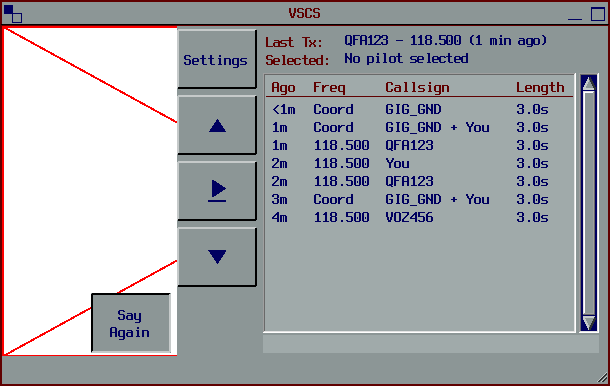
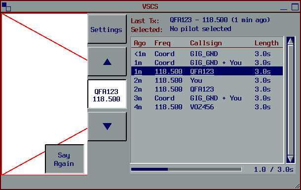
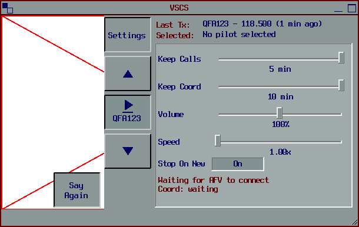

# Say Again

vatSys plugin that keeps the last few minutes of AFV frequency calls and hotline/coldline coord in memory so you can replay a missed call. Replay keys in vatSys's Keyboard settings, and a Say Again page on the VSCS to browse (the selected aircraft's calls highlighted) and play back. Memory only, never saved, wiped on disconnect.

| Say Again page | Playing | Settings |
| --- | --- | --- |
|  |  |  |

*Previews are rendered offline, so vatSys's own VSCS buttons (left) can't draw and show a red cross; in vatSys they appear as normal.*

## Details

Keeps the last few minutes of received AFV transmissions, and of hotline/coldline coordination, in memory so a controller can replay a missed call with one key.

- **One clip per transmission, per frequency**, tagged with callsign and frequency. Two stations on different frequencies at once become two clips.
- **Replay key** sits in vatSys's own *Settings → Keyboard* window, under *Quick Text*, as **Replay Last**. It captures exactly like PTT: left click for keyboard/mouse/joystick, right click for keyboard/mouse only, middle click to clear. It works when vatSys isn't focused.
- **Each key plays the most recent call of its kind** (Replay Last: frequency; Replay Coord: line call). Press again to hear the same call again from the start, as often as you need to work out what was said. Your own transmissions are skipped. Once a newer call comes in, the key plays that one. Older calls are on the Say Again page.
- Replay plays through vatSys's AFV output, so you hear it on the same headset and extra outputs at the vatSys volume.
- **Your own voice too**: your frequency transmissions (only real ones: PTT held with AFV connected and a frequency set to Transmit, one clip per press, on that frequency; pressing PTT as an observer records nothing) and your side of open lines (mixed into the line call's clip). Your frequency transmissions get vatSys's AFV mic gain, as AFV applies it. On lines vatSys sends the raw mic, so each side of a line call is brought up to a normal speech level (boost only, at most 8x) before mixing. Your transmissions show as "You" in the list and "YOU" on the VSCS.
- **Coord replay** (hotline/coldline), on its own key, **Replay Coord**, kept for up to **10 minutes**. Each line call becomes one clip with **both sides mixed** as you heard them (the other controller and you), labelled with who the call was with (e.g. `ML-BIK_CTR`). A call lasts from when vatSys opens the line until it closes it (vatSys's own hotline/coldline state; ringing doesn't count), pauses included at their real length (calls over 5 minutes are split). In the list its Freq shows **Hotline** or **Coldline**, and Callsign shows who the line was with, even if they never spoke (not you). A call nobody spoke on is still listed, with "silent" as its length; it has nothing to play, so the keys and ▲/▼ skip it. It plays back through vatSys's coord output at the coord volume. Only lines you had open are recorded, because vatSys mutes the others. Both sides are kept.
- **Frequency and coord kept apart**: a line is an open mic, so when a controller (or you) keys PTT with a line open, the same words arrive on frequency and on the line. vatSys also mixes each controller's frequency audio faintly into their line. Those coord copies are dropped and only the frequency clip is kept. The status line under Settings shows how many coord utterances were heard from others and from you, and how many were dropped as copies.
- **Say Again page on the VSCS**, in the page area where Setup, Coord and Text go:
  - **Getting there:** **Say Again** is a fifth menu button under Group, behaving like Setup, Coord and Text. The plugin raises the VSCS window's minimum height (318 → 386 px) so it always fits, and puts vatSys's original minimum back when it unloads. Clicking a frequency or menu button leaves the page, like any page change.
  - **Buttons:** Settings, ▲ (next), ▶ (play/pause, underlined), ▼ (previous). Next moves up the list (newer), Previous down it (older), in table order (frequency and coord together, newest first). While the page is open only Say Again shows pressed (vatSys sits on its Monitor page underneath). While a call plays, Play becomes a status button (in the VSCS receiving colour, like a frequency button receiving, with who and where, e.g. `QFA123` / `118.500`); click to pause, right click to stop. A call that finishes just stops.
  - **Call-outs:** **Last Tx** (`Callsign - FREQ (X mins ago)`, the most recent frequency call) and **Selected** (`callsign, name` of the pilot selected in vatSys). While a pilot is selected, that aircraft's calls are highlighted in the list (rows tinted with vatSys's Highlighted Text colour; turn it off with **Highlight Selected Pilot** in Settings). Nothing is hidden, and ▲/▼ still step through every call.
  - **List:** Ago (whole minutes), Freq, Callsign, Length, with a **progress bar** under it showing how far into the replay you are.
  - **Settings** (hidden until the Settings button is pressed, fits without scrolling): Keep Calls, Keep Coord, Volume, Speed, Stop On New Call, Highlight Selected Pilot, and the listening status.
  - **While a call replays and the page isn't open**, Say Again itself shows who and where in the VSCS receiving colour; right click stops it. Only one replay plays at a time.
- **Replay speed** 1.00x–2.00x (pitch unchanged), set in the Say Again window.
- Replay stops automatically when you key PTT, and (optionally, on by default) when a new call comes in.

## Privacy

- Audio is held **only in memory**, recorded at 8 kHz (radio bandwidth) and compressed with Opus (about 1 KB/s). It is never written to disk, logged, exported or copied anywhere.
- Calls are wiped (overwritten with zeros) after the retention time (frequency 1–5 min, coord 1–10 min; both are hard limits), on AFV/VATSIM disconnect, and when vatSys closes.
- The settings file (`%LOCALAPPDATA%\AFVReplay\settings.xml`) holds only the two key bindings, retention times, volume, speed and the stop option.
- Limitation: anything in a process's memory can be read by someone with a memory dump of their own PC. This design makes the data short-lived and unavailable through any normal means, which is as far as a plugin can go.

## How it works

vatSys runs the AFV client in-process. Each frequency's receiver feeds a mixer before the headset. The plugin swaps each receiver in that mixer for a pass-through *tap* that copies the audio and listens to AFV's own "who is transmitting" events to cut clips. A replay player is added to the same mixer. It re-checks twice a second because AFV adds and removes receivers as frequencies change, and rebuilds everything on reconnect.

Coord audio comes from vatSys's own Mumble client, not AFV. An open line streams continuously (vatSys has no push-to-talk or gate on lines), so utterances are found by level against each controller's own noise floor: a 30 ms onset, 300 ms pre-roll and 1.2 s hangover. The plugin listens on the client's "audio received" event and adds its coord player to the client's output mixer. If a vatSys update changes any of that, only coord replay switches off.

All use of vatSys/AFV internals is in [VatSysBridge.cs](src/AFVReplay/VatSys/VatSysBridge.cs). At startup the plugin checks every internal it needs. If a vatSys update has changed any of them, it disables itself and reports this in the vatSys error window instead of misbehaving.

Built and tested against **vatSys 0.4.9305.35667**.

## Install

**vatSys Launcher:** install **Say-Again** from the launcher's plugin list (once listed). It goes into `Plugins\Say-Again` and the launcher keeps it up to date.

**Manually:** download `Say-Again-v<version>.zip` from the [latest release](https://github.com/Verbjimtim/Say-Again/releases/latest) and unzip it into `Documents\vatSys Files\Profiles\<profile>\Plugins\Say-Again` (one profile) or `vatSys\bin\Plugins\Say-Again` (all profiles). Restart vatSys.

Only install it once: if vatSys finds two copies, the second disables itself and says where both are.

**From source (development):**

```powershell
powershell -ExecutionPolicy Bypass -File .\install.ps1            # all profiles: vatSys\bin\Plugins\AFVReplay (asks for admin)
powershell -ExecutionPolicy Bypass -File .\install.ps1 -Profile   # current profile only, no admin
powershell -ExecutionPolicy Bypass -File .\install.ps1 -Uninstall
```

`-ExecutionPolicy Bypass` applies to that one run only. It's needed when Windows is set to block scripts, and it doesn't change the system setting. Close vatSys before installing, because it locks the plugin DLL while running. Then start vatSys again, since plugins only load at startup.

## Releasing

```powershell
powershell -ExecutionPolicy Bypass -File .\release.ps1   # artifacts\Say-Again-v<version>.zip
```

Set `<Version>` in `src/AFVReplay/AFVReplay.csproj`, add a CHANGELOG entry, then attach the zip to a GitHub release tagged `v<version>` (not a pre-release: the launcher reads the latest release). The DLL's file version is what the launcher compares to decide an update is available.

## Tests

```powershell
dotnet build tests\AFVReplay.Tests -c Release
.\tests\AFVReplay.Tests\bin\Release\net472\AFVReplay.Tests.exe
```

The harness loads vatSys's own DLLs (x86) and drives the **real AFV receive pipeline** with Opus packets at real AFV pacing. It covers: the bridge matching the installed vatSys, splitting, blips, stuck-mic splitting, two frequencies at once, duplicate-transceiver collapse, receivers being added/removed, unhook restoring AFV, live audio unchanged by the tap, replay level matching live, replay key repeating the newest call (own transmissions skipped), stop on new call, time-stretch length/pitch/level, replay speed, the VSCS grid placement, Say Again table-order playback (previous/next, pause/resume, progress), coord utterance cutting (noise, frequency loopback and blips ignored, line hang-up), the 10 min coord cap, one replay at a time, coord end to end through vatSys's real Mumble client objects (coord replay level matches live), expiry/wiping, settings, and reading vatSys's key-binding format.

**Not covered offline** (needs vatSys running): the VSCS button with real frequencies drawn beside it, how sped-up speech sounds, the Keyboard window row, DirectInput key polling, the menu/window, and real network audio.

## First live test checklist

1. Install, start vatSys, connect (Sweatbox has no AFV voice, so use the live network).
2. Say Again → Settings: the status should read "Listening on N receiver(s)".
3. *Settings → Keyboard*: "Replay Last" and "Replay Coord" should appear under Quick Text. Set a key and confirm PTT still works afterwards.
4. Let a few calls come in on two frequencies. Check the list shows the right callsign/frequency, then press the key: it plays the newest call, and pressing again repeats it.
5. Open a hotline or coldline and have the other controller talk. A "Coord" row should appear for each thing they say, and the Replay Coord key or the COORD button should replay it in your coord audio.
6. Open Say Again (under Group). Step with Next/Previous, pause and resume, watch the progress bar; open Settings and try 1.25x and 1.5x speed. Switch page during a replay: Say Again shows who/where; right click stops.
7. Key PTT during a replay; it should stop. Disconnect; the list should empty.
8. Any problem shows in the vatSys error window under "Say Again".

## Layout

```
src/AFVReplay/
  ReplayPlugin.cs          entry point (MEF IPlugin), wiring, privacy wipes
  ReplayController.cs      replay key: most recent call, press again to repeat
  ReplaySettings.cs        preferences only
  Audio/                   tap, recorder, finalizer (dedupe + Opus), store, player, hook
  Input/                   vatSys key-binding format, DirectInput poller
  UI/                      Keyboard window rows, VSCS Say Again button and page
  VatSys/VatSysBridge.cs   every vatSys/AFV internal in one place
tests/AFVReplay.Tests/     offline harness
```

## Privacy note (shown to users)

Calls are kept in memory only and never saved. They are deleted after the retention times, on disconnect, and when vatSys closes. Your own voice is kept only while PTT is held or a line is open.
